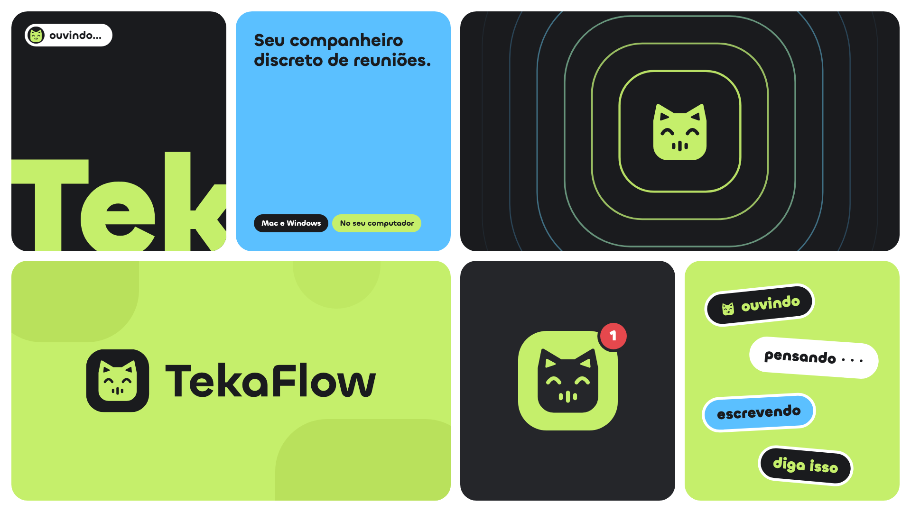

  

<h3 align="center">Seu companheiro discreto de reuniões.</h3>

  Ele ouve junto e sussurra uma sugestão quando você precisa, 
  com a IA que você já usa.

  
  

  

## Uma reunião, um companheiro por perto

Entrevista, chamada de venda, apresentação, conversa difícil. Em qualquer reunião ao vivo, o TekaFlow fica ao seu lado, ouvindo. Quando alguém faz uma pergunta, ele escreve uma sugestão de resposta, em primeira pessoa, pronta para você dizer do seu jeito. Se quiser.

  

## Como começa

| | |
|---|---|
| **1. Abra** | Instale o app no Mac e libere o microfone, o reconhecimento de voz e a gravação de tela. São poucos passos até a primeira sugestão. |
| **2. Conecte** | Use a IA que você já tem: ChatGPT, Claude Code ou uma chave de API. Sem assinatura nem créditos próprios do TekaFlow. |
| **3. Escolha a pasta** | Aponte a pasta com o seu currículo, a vaga, as notas ou o briefing. As sugestões se apoiam no que está lá. |
| **4. Inicie a reunião** | O TekaFlow confere o microfone, a transcrição e o modelo, abre uma janelinha discreta e começa a ouvir. |

## O que ele faz por você

- **Ouve você e os outros.** Capta o seu microfone e o som do computador, cada um separado, e transcreve conforme a conversa acontece.
- **Sugere durante a conversa.** Quando os outros perguntam, a sugestão aparece sozinha, com o nome do arquivo de onde veio.
- **Fala como você.** A sugestão sai em primeira pessoa e leva em conta o que você já disse, para complementar e não contradizer.
- **Conhece os seus arquivos.** PDF, Markdown e texto da pasta que você escolher entram como contexto.
- **Guarda tudo.** A transcrição é salva aos poucos em `Documentos/TekaFlow`, uma pasta por reunião. Se o app fechar no meio, o que foi dito está lá.
- **Fica pequeno.** Uma janelinha por cima, que você minimiza quando quiser. Nada de painel cheio.
- **Avisa com calma.** Se o microfone não captar som, ele diz o que aconteceu e o que fazer, e a reunião segue aberta.

## Seus dados

- A transcrição acontece no seu Mac, com o Apple Speech ou com o Whisper.
- A pergunta e o contexto vão para a IA que você escolheu. Com ChatGPT, Gemini ou chave de API, isso passa pelo serviço dela, e a conta pode ter custo no provedor.
- As chaves ficam no cofre do sistema. As reuniões ficam numa pasta sua.

## Para Mac, agora

| | |
|---|---|
| **Sistema** | macOS com Apple Silicon (M1 em diante) |
| **Instalação** | Baixe o `.zip` na [página de versões](https://github.com/robertfxbr/TekaFlow/releases/latest) e arraste o TekaFlow para Aplicativos |
| **Primeira abertura** | O app ainda não é assinado pela Apple. Clique com o botão direito, escolha **Abrir** e confirme |
| **Whisper (opcional)** | `brew install whisper-cpp`. O Apple Speech funciona sem isso |

## Para Windows

| | |
|---|---|
| **Sistema** | Windows 10 ou 11, 64 bits |
| **Instalação** | Baixe o `TekaFlow-Setup` na [página de versões](https://github.com/robertfxbr/TekaFlow/releases/latest) e rode. O instalador ainda não é assinado, então o SmartScreen pode avisar na primeira vez |
| **Atualização** | O app se atualiza sozinho. Quem está na 0.4.16 ou antes baixa o instalador uma vez; os dados continuam lá |
| **Whisper** | Já vem no instalador, com opção de usar a placa de vídeo |

O app para Windows começou como OpenPerssua. Os detalhes técnicos dele estão em [WINDOWS.md](WINDOWS.md).

## Uma versão, dois sistemas

Mac e Windows seguem o mesmo número de versão. Cada versão é uma release só, `vX.Y.Z`, com os arquivos dos dois: o app para Windows sobe do PC do Robert e o do Mac é gerado na nuvem do GitHub quando a tag é criada. Cada app baixa só o que é dele. O passo a passo está no [RELEASE.md](RELEASE.md).

## Perguntas rápidas

**Preciso pagar o TekaFlow?** O app não cobra assinatura nem vende créditos. A conta da IA que você conectar pode ter custo no provedor dela.

**Ele aparece para os outros na chamada?** O TekaFlow fica na sua tela, numa janela que você controla. Ele é discreto, não promete esconder nada de ninguém.

**Qual IA ele usa?** A que você conectar: ChatGPT, Claude Code ou uma chave de API.

**Onde ficam as reuniões?** Em `Documentos/TekaFlow/Reuniões`, uma pasta por reunião, com a transcrição em texto.

## Para quem constrói

| Pasta | App |
|---|---|
| `app/`, `design-system/` | Mac |
| `electron/`, `src/`, `package.json` na raiz | Windows |

O TekaFlow tem Design System próprio, gate de qualidade e regras de escrita da marca. Antes de criar ou subir qualquer coisa, leia o [CLAUDE.md](CLAUDE.md) e o [guia de contribuição](docs/CONTRIBUINDO.md). Para lançar uma versão, veja o [RELEASE.md](RELEASE.md).

## Créditos

O TekaFlow parte do projeto original de Robert, [openPerssua](https://github.com/robertfxbr/openPerssua), idealizado, dirigido e mantido por ele, com licença MIT. O aviso de copyright dele está no [LICENSE](LICENSE). A versão para Mac, o Design System e a marca do TekaFlow são de Carlos Henrique.
